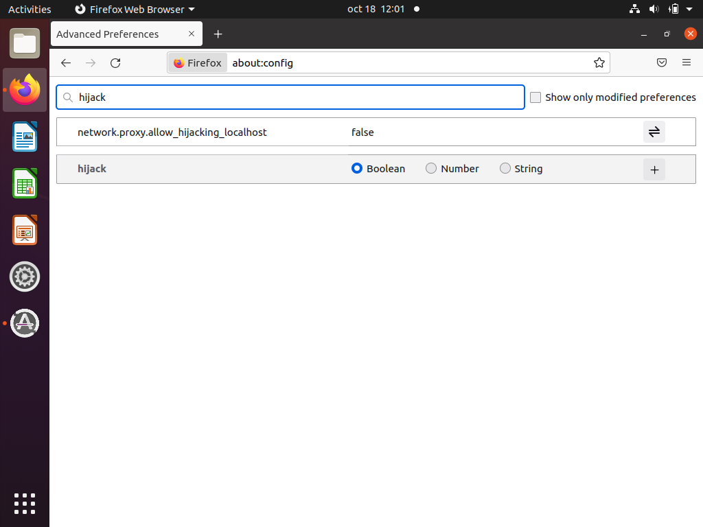
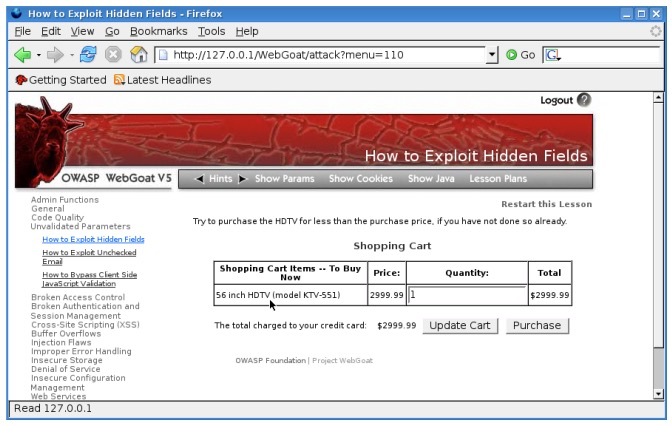
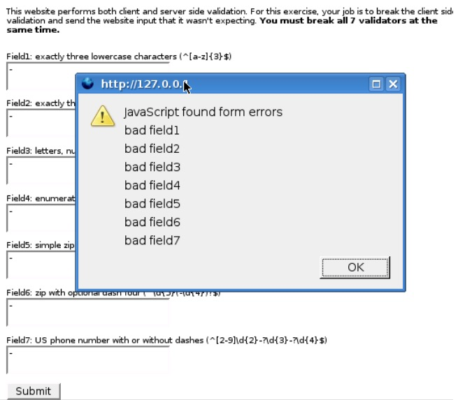
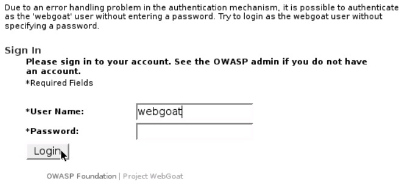
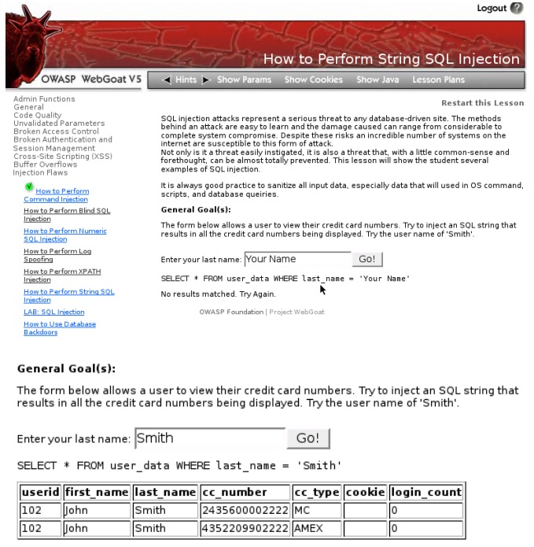
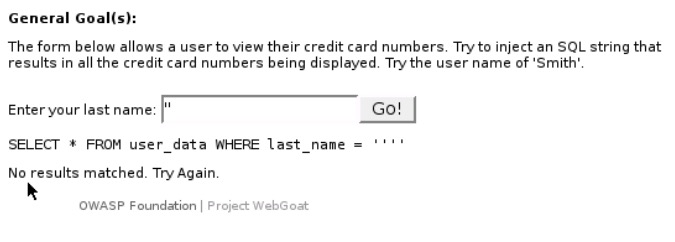
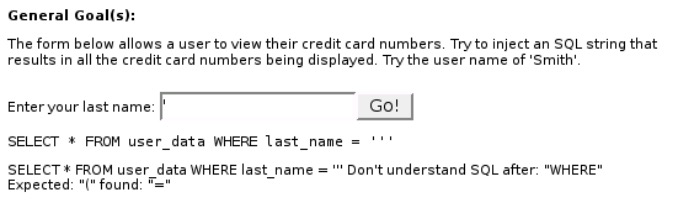
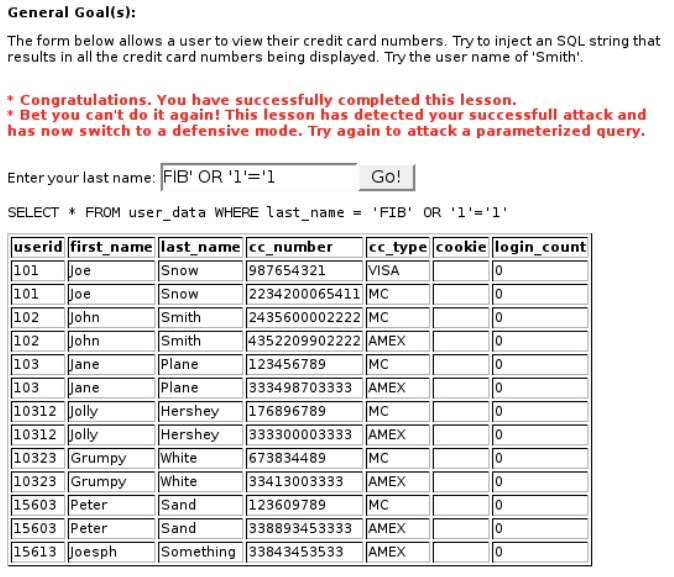
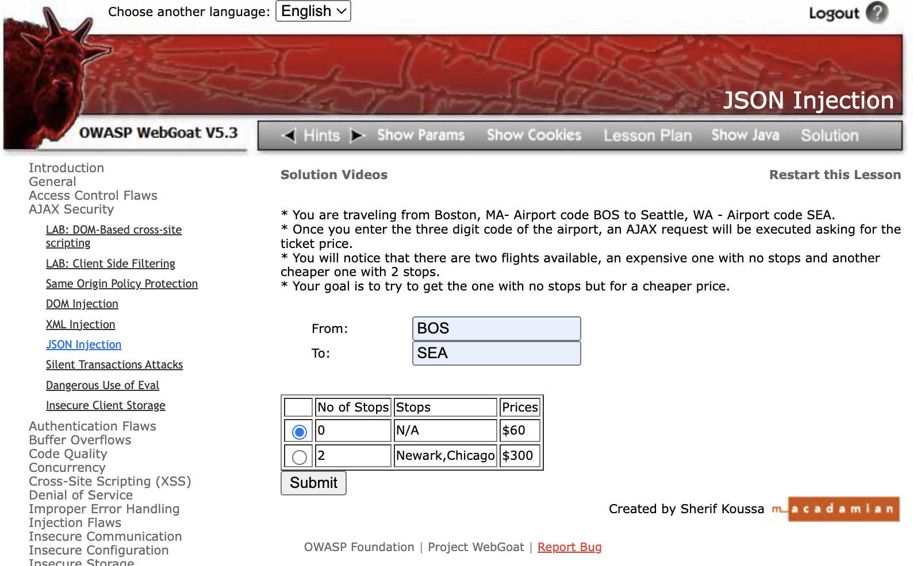

# Lab 2: Vulnerabilities in web applications

## Contents

- [Objective](#objective)
- [How to install](#how-to-install)
- [Exercises](#exercises)
  - [Parameter Tampering](#parameter-tampering)
    - [Hidden fields](#hidden-fields)
    - [e-mail not validated](#e-mail-not-validated)
    - [Avoid validations on the client side](#avoid-validations-on-the-client-side)
  - [Improper Error Handling](#improper-error-handling)
    - [Fail Open Authentication Scheme](#fail-open-authentication-scheme)
  - [Session administration and authentication](#session-administration-and-authentication)
    - [Authentication using cookies](#authentication-using-cookies)
  - [Injection Flaws](#injection-flaws)
    - [SQL Injection](#sql-injection)
  - [AJAX Security](#ajax-security)
    - [JSON Injection](#json-injection)
- [Quiz](#quiz)
- [Deliverables](#deliverables)
- [References](#references)

## Objective

Vulnerabilities in web applications are responsible for most of the security
violations in computer networks. Every time more often, the attacks are
addressed to applications such as Internet shopping, web forms, as well as the
authentication and access points to protected web pages and dynamic contents
from linked databases with transactions and information requests. When we talk
about web application vulnerabilities we are not talking about operating system
or HTTP server vulnerabilities (version update, patches, etc.) but about the
vulnerabilities of the software on top of them. Such vulnerabilities are
directly related to the logic, code scripting and content of the web
application. Being able to detect such vulnerabilities provides us with more
security as well as to be able to provide more control and quality to our
software products. The objective of this session is to study some of the main
vulnerabilities found in web applications, study some basic ways to perform
attacks and understand the origin of such vulnerabilities and how to be able to
avoid them. We will use the following applications for this session:

- **WebGoat** is a J2EE application developed by OWASP (The Open Web Application
  Security Project) and based on Tomcat. It is an insecure application, and it
  is basically its purpose. The objective is to use it as an introduction to
  different attacks directed to web applications (test environment). It has
  different lessons that provide us with help and information to understand and
  to be able to overcome them.
- **OWASP ZAP** is an intercepting proxy and security scanner developed by
  OWASP. It sits between the browser and the web application, so you can study
  the requests and responses and change them before they reach the server or
  the browser.

## How to install

1. Run the OWASP ZAP image, which shows the ZAP desktop in a browser tab:

   ```bash
   podman run -it --rm --name zaproxy \
     -p 127.0.0.1:3000:8080 \
     -p 127.0.0.1:8090:8090 \
     ghcr.io/zaproxy/zaproxy:stable zap-webswing.sh
   ```

   Open <http://127.0.0.1:3000/zap/>. ZAP opens a "Manage Add-ons" window; close
   it. If ZAP asks "Do you want to persist the ZAP Session?", choose "No, I do
   not want to persist this session at this moment in time" and click "Start".
   ZAP starts its proxy on port `8090` only after you answer that prompt, so
   answer it before you browse. To stop ZAP, close the tab and press `Ctrl+C` in
   the terminal.

2. Run WebGoat in Podman:

   ```bash
   podman run --name webgoat -it --rm -p 8080:8080 ghcr.io/fib-gei-si/webgoat_legacy
   ```

3. Open "Tools → Options → Breakpoints" in ZAP. Set "Break Buttons Mode" to
   "Separate Request and Response Buttons" and enable "Show buttons to select
   the requests you don't want ZAP to break on". The top toolbar then has one
   button for requests and one for responses, and the Break tab has buttons to
   ignore JavaScript, CSS and Fonts, and Multimedia files.

   ZAP traps the next message after you press a break button, and that message
   is not always the one you want: Firefox sends background requests, and a
   page loads many files. Click "Step" to forward the trapped message and trap
   the next one.

4. Configure Firefox:
   a. Open `about:config` writing it in the address bar and set
      `network.proxy.allow_hijacking_localhost=true` to allow proxy to
      localhost and `app.update.auto=false` to disable automatic updates.

      

   b. Open `about:preferences` writing it in the address bar to open the
      general settings. Type "network" in the search bar to open "Network
      Settings" to manually configure the proxy option. Select "Manual proxy
      configuration" and set the HTTP proxy to `127.0.0.1` port `8090`. Leave
      the HTTPS proxy empty. WebGoat uses plain HTTP, and proxying HTTPS
      without ZAP's certificate makes Firefox warn on every site. Observe that
      the field "No Proxy for" does not contain "127.0.0.1" or "localhost".

5. Open WebGoat. If ZAP runs in the Podman container, use
   <http://host.containers.internal:8080/webgoat/attack>, because from inside
   the container that name resolves to your computer, where WebGoat listens on
   port `8080`. If ZAP runs on your computer, use
   <http://127.0.0.1:8080/webgoat/attack>. Log in with user/pass: guest/guest.

## Exercises

The vulnerabilities that we are going to see are:

- **Parameter Tampering:** how to obtain additional information from web
  applications and modify the client's generated requests or server responses
  to be able to perform the attack.
- **Weak session identification:** we will see the dangers of weak
  authentication, and in this case, how to impersonate another user by means of
  a session cookie.
- **Injection Flaws:** it is a vulnerability found at the input data validation
  of a database associated with a web application. The origin is the incorrect
  filtering of variables used in the application code.

### Parameter Tampering

We will see the danger of not validating input parameters on a Web application
or doing a poor or incorrect validation. On "Parameters tampering" we will find
four exercises:

#### Hidden fields

Access to WebGoat's lesson "Exploit Hidden Fields" in "Parameter Tampering".
Its goal is to buy from a web page for a lower price.

Observing the web page, we can see that the field "Price" can't be modified.
Try several times "Update chart" or "Purchase" or observing the code, clicking
"Show Java" to modify the product's price. Have you found anything?



Let's now watch the request sent to the server when we try to buy. Follow the
steps:

- Click "Set break on all requests" in ZAP's top toolbar.

- Once the requests' interception has been activated, go back to WebGoat and
  try to buy by clicking on "Purchase".

- ZAP traps the request and shows it in the "Break" tab. Open the "Body" view
  of the request panel and find the variables (QTY, SUBMIT, Price). One of the
  variables refers to the purchase price. Change the value of the price, then
  click "Continue" in the toolbar to send the changed request.

#### e-mail not validated

Go to WebGoat lesson "Exploit unchecked mail" in "Parameter Tampering". Now the
goal is to be able to change the e-mail address where the comments typed at the
web page are sent. Enter some comments and see the code by clicking on "Show
Java" to be able to modify the e-mail address. Have you found anything?

- Type a malicious script like the following one into the comments field and
  send:

  ```javascript
  <script>alert("XSS")</script>
  ```

- Observe that you are able to add your own script and execute whatever you
  want. Now, let's change the e-mail address field. Click "Set break on all
  requests" in ZAP and send the comments. In the request body of the Break tab
  change the hidden field "to" from `webgoat.admin@owasp.org` to
  `alumne@fib.upc.edu` (don't worry, no email is actually sent during this
  test), then click "Continue".

#### Avoid validations on the client side

Go to WebGoat lesson "Bypass Client Side JavaScript Validation" in "Parameter
Tampering". The goal is to avoid validation implemented on the client side of
the application.

This web page sends seven values to the web server that need to match regular
expressions validated locally. Try introducing correct and incorrect values on
every field and send them clicking on "Submit" or observing the code clicking
on "Show Java" to be able to find the code implementing the fields' validation.
Have you found anything?

What would happen if we sent incorrect values in all the fields? For instance,
a dash (-).



Data is being validated at the client side, and we can't send it to the server.
Looking at the code, you can find the section implementing the validation:

```javascript
if (!pattern1.matcher(param1).matches()) {
    err++;
    msg += "<BR>Server side validation violation: You succeeded for Field1.";
}
if (!pattern2.matcher(param2).matches ()) {
    err++;
    msg += "<BR>Server side validation violation: You succeeded for Field2.";
}
...
if (err > 0) {
    s.setMessage(msg);
}
```

This code is downloaded when requesting the web page. Let's try to skip the
validation.

We need to intercept the server's responses. Click "Set break on all
responses" in ZAP's top toolbar. ZAP also traps the scripts, style sheets and
images of the page. When ZAP traps one of these files, click the "Set ignore
breaks" buttons for JavaScript, CSS and Fonts, and Multimedia in the Break tab
to stop breaking on that kind of file.

Reload the browser's page to issue a new request. ZAP traps the response of
the page in the "Break" tab. Open the "Body" view of the response panel and
find there the code to validate the fields that we want to avoid.

Edit the validate code, forcing the error count to 0 by adding `err=0;` before
`if (err>0) alert(msg);`. Click "Continue" in the toolbar to send the changed
response to the browser, go back to the web page and click "Submit" to send
incorrect data to the server. We have been able to avoid the client's validation
and to send incorrect information to the server.

Open the browser console (right click → Inspect → Console) and paste the
snippet to obtain the SHA256 from the message in red that appears when you pass
the exercise. Otherwise use an online tool like
<https://emn178.github.io/online-tools/sha256.html> to get the SHA256 digest by
copying and pasting the text in red.

```javascript
// You need to type in console `allow pasting` and hit enter.
// This is one time thing and will enable the pasting functionality.

// If this code doesn't work on your browser, take the output from:
// document.querySelector("#message.info").innerText.trim()
// and use an online tool like https://emn178.github.io/online-tools/sha256.html
// to get the SHA256 digest

async function sha256(rawData) {
  const data = typeof rawData === 'object' ? JSON.stringify(rawData) : String(rawData);

  const msgBuffer = new TextEncoder().encode(data);
  const hashBuffer = await crypto.subtle.digest('SHA-256', msgBuffer);
  const hashArray = Array.from(new Uint8Array(hashBuffer));
  return hashArray.map(b => b.toString(16).padStart(2, '0')).join('');
}

sha256(document.querySelector("#message.info").innerText.trim()).then((hash) => { console.log(hash); });
```

### Improper Error Handling

#### Fail Open Authentication Scheme

Go to WebGoat lesson "Fail Open Authentication Scheme" in "Improper Error
Handling". Try solving the lesson bypassing the authentication check by
generating an uncaught error in the server.

- Enter username "webgoat" and leave the password empty.

  

- Click "Set break on all requests" in ZAP, then click "Login".
- In the request body of the Break tab delete the whole "Password" parameter,
  its value and the "&" that joins it to the previous parameter, then click
  "Continue".

You are now "authenticated" as WebGoat.

### Session administration and authentication

#### Authentication using cookies

We'll see now how applications use cookies to maintain session information and
how that information can be used to establish a session for a different user
without having its credentials.

Go to WebGoat lesson "Spoof an Authentication Cookie" in "Session Management
Flaws". The goal is to be able to establish a session as user "Alice" without
having her credentials.

Try authenticating as "webgoat/webgoat" and "aspect/aspect" reloading the
screen to observe how the web page uses the cookie to validate and maintain the
session. Watch the code, clicking on "Show Java" to be able to establish a
session as user "Alice". Have you found anything?

Let's take a look at the mechanism used to authenticate using the cookie:

- Log in as "webgoat".

- Click "Set break on all requests" in ZAP and click "Refresh". ZAP traps the
  request and shows it in the "Break" tab; observe the value of the cookie in
  the "Header" view of the request panel. Click "Continue" to forward it.

- You can also read the cookie without breaking requests. Select the request in
  the "History" tab and open the "Request" tab; the Cookie header shows the
  value.

- Do the same for the user "aspect" observing the value of the cookie; compare
  it with the one for the user "webgoat".
- Repeat the same process several times, observing the value of the cookie for
  each user.

The value of the variable "AuthCookie" for each user is always the same.
Therefore we can think that if we find the logic that generates that value we
can try to modify the cookie to simulate a session for another user. Let's
study each value:

| User    | AuthCookie  |
| ------- | ----------- |
| webgoat | 65432ubphcfx |
| aspect  | 65432udfqtb  |
| Alice   | 65432?????   |

We can see that the variable "AuthCookie" always begins with "65432", we will
then concentrate on the variable part.

It looks like the number of characters of the username is directly related to
the generated code:

- webgoat 7 characters → upbhcfx 7 characters
- aspect 6 characters → udfqtb 6 characters
- alice 5 characters ... we may then think that the code will have 5 characters

Let's now try finding some relationship amongst the characters: The code
generated for both users begins with "u" but the username doesn't begin with
the same character. But we see that both end in "t". Reversing the order:

| User    | AuthCookie |
| ------- | ---------- |
| taogbew | ubphcfx    |
| tcepsa  | udfqtb     |

Now, we only need to observe the characters a bit longer to discover that each
character corresponds to one of the characters of the username in the
"AuthCookie" alphabet. That's a variant of the Caesar enciphering, classic and
very basic method where a character is replaced by another one, with a
bijective correspondence.

```
t->u, a->b, o->p, g->h, b->c, e->f, w->x
t->u, c->d, e->f, p->q, s->t, a->b
```

Therefore, to generate the code for user "alice":

| User    | AuthCookie  |
| ------- | ----------- |
| webgoat | 65432ubphcfx |
| aspect  | 65432udfqtb  |
| Alice   | 65432fdjmb   |

Now, let's send the server the modified value of "AuthCookie": start a session
for user "webgoat" or "aspect", click "Set break on all requests" and
click "Refresh". On the request trapped in the Break tab, modify the value for
"AuthCookie" using the one we have calculated, and click "Continue".

You can now see a page that is greeting user "alice".

### Injection Flaws

#### SQL Injection

We are going to study how to insert SQL sentences inside a previously written
query in order to manipulate the correct procedures of a given application.

Go to WebGoat lesson "String SQL Injection" (not "LAB: SQL Injection") in
"Injection Flaws". Its goal is to obtain a listing of the credit cards stored
in a database. Type "Smith" as a parameter and try other values. Observe the
results and study how the SQL sentence providing the listing is modified. See
that the query is waiting for a value to be entered and then used.



What if we type two quotes without any value?



The SQL sequence is correct and returns no value. What if we type just one
quote?



Now the SQL syntax is not correct: it requires a quote at the beginning of a
string and another one at the end. We must then find a correct SQL sentence
that is always true. Enter this text for "last_name" and execute the query by
clicking on "Go!"

```sql
FIB' or '1' = '1
```

We can close the first quote with any value and then add an expression that
always is true (`"1"="1"`). We need to remember that a quote is added at the
end. The Boolean OR operator will make the trick, returning all the values of
the table.



We have finally achieved to list all the values of the customer's credit cards
stored in the database.

### AJAX Security

#### JSON Injection

Go to WebGoat lesson "JSON Injection" in "AJAX Security". Its goal is to try to
get the cheaper direct (without stops) flight between Boston (BOS) and Seattle
(SEA).

Like with the previous lessons, you need to manipulate the HTTP Response using
ZAP.

- Examine the normal flow by entering the airport code BOS and SEA. Click "Set
  break on all responses" in ZAP before you send the request. ZAP traps the
  JSON response in the "Break" tab.

- Open the "Body" view of the response panel, change the price for the
  expensive flight of $600 to $60 and click "Continue".
- Select the flight with no stops and the updated price and click "Submit".

  

We managed to purchase the cheapest flight.

## Quiz

Answer the following questions in the Atenea form.

1. What is the name of the parameter that you had to modify to pass the
   Exploit Hidden Fields lesson in the Parameter Tampering category?

2. What vulnerabilities does the "Parameter Tampering - Exploit unchecked
   mail" exercise present, and what are some of its possible exploits?
   (Choose one or more)

   - a. Theft of the administrator's credentials
   - b. Anonymous email sending
   - c. Relay for spam campaigns
   - d. Cross Site Scripting (XSS)
   - e. SQL injection
   - f. Bitcoin mining

3. Paste the sha256 hash (complete or the first 8 characters) of the message
   that appears in red when the "Bypass Client Side JavaScript Validation"
   exercise in the "Parameter Tampering" category is passed.

4. When you pass the "Fail Open Authentication Scheme" exercise in the
   "Improper Error Handling" category, the following message appears:

   > Welcome, webgoat
   >
   > You have been authenticated with [ANSWER]

   Complete the answer.

5. What value would the cookie of a hypothetical user "sifib" have?

6. What is the credit card number of Joseph Something?

7. Paste the whole modified response JSON that would let you get the expensive
   flight for \$60.

8. What is the version of Tomcat that serves the webgoat application? (give
   only the numbers separated by dots)

9. What is the CVE of the vulnerability published in 2009 for the Tomcat
   server that serves the webgoat application?

10. What is the value of the "Server" field in the webgoat response headers?
    (exact string)

## Deliverables

Submit the file `si-lab2.tar` in Atenea. The archive holds one image per [Quiz](#quiz)
question, named `P1.png` to `P10.png`.

Each image is a full screen capture that shows:

- The current date the system reports (real local time).
- The browser and/or WebGoat application with your answer to the question. Include
  the steps that solved the exercise. Do not submit only the final screen that
  reports the exercise passed.

## References

- OWASP Project: <https://owasp.org>
- OWASP ZAP: <https://www.zaproxy.org>
- OWASP Source Code Center: <https://sourceforge.net/projects/owasp/>
- Web Application Security Consortium (WASC): <http://www.webappsec.org>
- Common Vulnerabilities and Exposures (CVE): <https://www.cve.org>
- RFC 1945, HTTP/1.0: <https://www.rfc-editor.org/rfc/rfc1945.html>
- RFC 2616, HTTP/1.1: <https://www.rfc-editor.org/rfc/rfc2616.html>
- RFC 2660, Secure HTTP: <https://www.rfc-editor.org/rfc/rfc2660.html>
- Secure Coding: Principles & Practices: <https://www.securecoding.org>
