# Lab 3: Federated authentication and authorization

## Contents

- [Objective](#objective)
- [How to install](#how-to-install)
  - [Configure Identity Provider](#configure-identity-provider)
  - [Configure Service Provider](#configure-service-provider)
  - [Link the accounts](#link-the-accounts)
- [Exercise](#exercise)
- [Deliverables](#deliverables)
- [References](#references)

## Objective

When dealing with distributed scenarios, it is common to use federated
authentication, this allows to delegate all the authentication tasks to a third
party. In this lab, we will install and configure a federated environment with
two Keycloak servers: an Identity Provider and a Service Provider.

The browser talks OpenID Connect to the Service Provider, which serves the web
applications. The Service Provider talks SAML to the Identity Provider, which
holds the credentials. To do this, we will simulate ownership of a public
domain. The domain we will be using is `siupc.cat`.

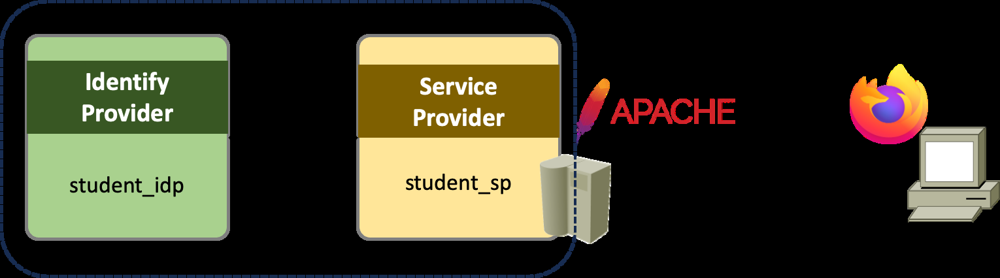

## How to install

**IMPORTANT:** Before starting, make sure that you don't have any container
running on podman:

```bash
podman ps
```

If there is, stop and delete it by running:

```bash
podman stop [container name] && podman rm [container name]
```

**IMPORTANT:** Keycloak keeps the realms, the users and the keys inside the
container. Use `podman stop` and `podman start` between sessions. If you delete a
container, its realm is gone, and the two servers no longer trust each other,
because the keys change. The realm keys stay when you only stop the container.

1. Create the podman network that will be used by the containers to talk to each
   other:

   ```bash
   podman network create keycloak
   ```

2. Start a forward proxy on the network:

   ```bash
   podman run -d --network keycloak --name proxy -p 127.0.0.1:8008:8008 \
     -e PORT=8008 -e DISABLE_VIA_HEADER=1 docker.io/kalaksi/tinyproxy
   ```

   The host cannot resolve the `siupc.cat` names and cannot reach the containers
   of a rootless network. The proxy runs inside the network, so it resolves the
   names with Podman DNS. The browser sends every request to the proxy.

3. Configure the HTTP proxy in Firefox:

   1. Open `about:preferences` and type "network" in the search bar.
   2. Open "Network Settings" and select "Manual proxy configuration".
   3. Set "HTTP Proxy" to `127.0.0.1` and "Port" to `8008`.
   4. Clear the "No Proxy for" field.

### Configure Identity Provider

1. Start Keycloak for the Identity Provider in Podman:

   ```bash
   podman run -d --network keycloak -h idp.siupc.cat --name idp_keycloak \
     -e KC_BOOTSTRAP_ADMIN_USERNAME=admin -e KC_BOOTSTRAP_ADMIN_PASSWORD=coliflor \
     quay.io/keycloak/keycloak:26.8 start-dev
   ```

2. Configure the service. The container needs about a minute to start. If the
   page does not load, wait and reload. Open a Web Browser to
   <http://idp.siupc.cat:8080/admin> and log in with `admin` / `coliflor`. The
   administration console opens in the `master` realm. The yellow banner about a
   temporary admin user is expected, and it does not affect the lab.

3. Create the realm for the Identity Provider. Manage realms / **Create realm**,
   name it `siupc-idp` and click **Create**. Keycloak switches to the new realm.

   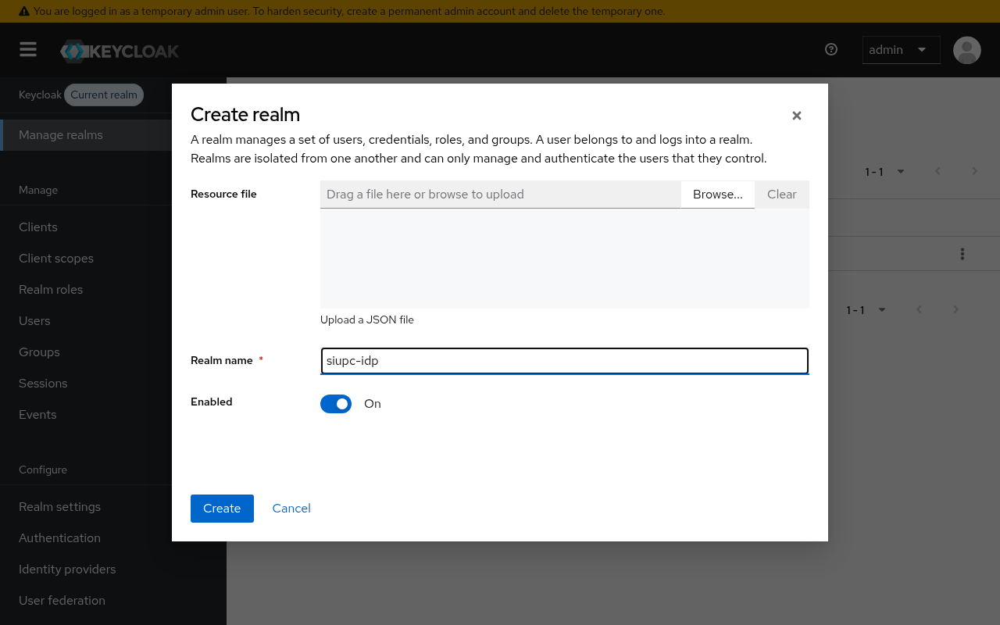

4. Create a user. **Users** / **Create new user** (the button reads **Add user**
   once the realm has users), and fill in the username `student_idp`, the email
   `student@siupc.cat`, and your first and last name.

   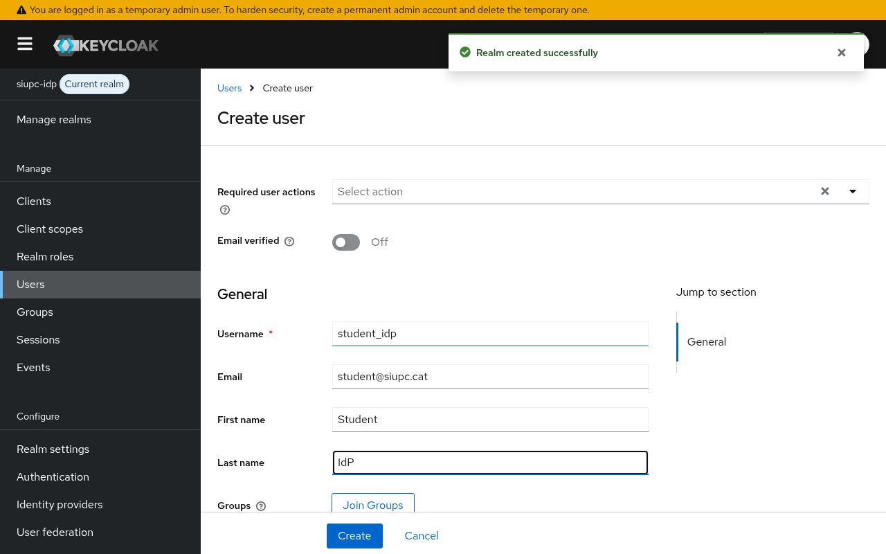

5. Set the password. Open the user, go to **Credentials** / **Set password**,
   write `coliflor` twice, turn **Temporary** off, click **Save** and confirm
   with **Save password**. A temporary password forces a password change on the
   first login, and that change gets in the way of the federation.

6. Note the SAML metadata of this realm. The Service Provider needs it, and the
   administration console shows it under **Realm settings** / **General** /
   **Endpoints** / **SAML 2.0 Identity Provider Metadata**:

   ```text
   http://idp.siupc.cat:8080/realms/siupc-idp/protocol/saml/descriptor
   ```

### Configure Service Provider

1. Start Keycloak for the Service Provider in Podman:

   ```bash
   podman run -d --network keycloak -h sp.siupc.cat --name sp_keycloak \
     -e KC_BOOTSTRAP_ADMIN_USERNAME=admin -e KC_BOOTSTRAP_ADMIN_PASSWORD=coliflor \
     quay.io/keycloak/keycloak:26.8 start-dev
   ```

2. Configure the service. The container needs about a minute to start. Open a
   Web Browser to <http://sp.siupc.cat:8080/admin> and log in with
   `admin` / `coliflor`.

3. Create the realm for the Service Provider. Manage realms / **Create realm**,
   name it `siupc` and click **Create**.

4. Create a user. **Users** / **Create new user**, with the username
   `student_sp`, your first and last name, and the same email as the IdP user,
   `student@siupc.cat`. Set the password like before, with **Credentials** /
   **Set password** and **Temporary** off. Both accounts belong to the same
   student, and the federation uses the email to recognize it.

5. Create the federation. Go to **Identity providers** and pick **SAML v2.0**.
   Keep **Use entity descriptor** on, and put the metadata URL of the Identity
   Provider in **SAML entity descriptor**. Click **Add**.

   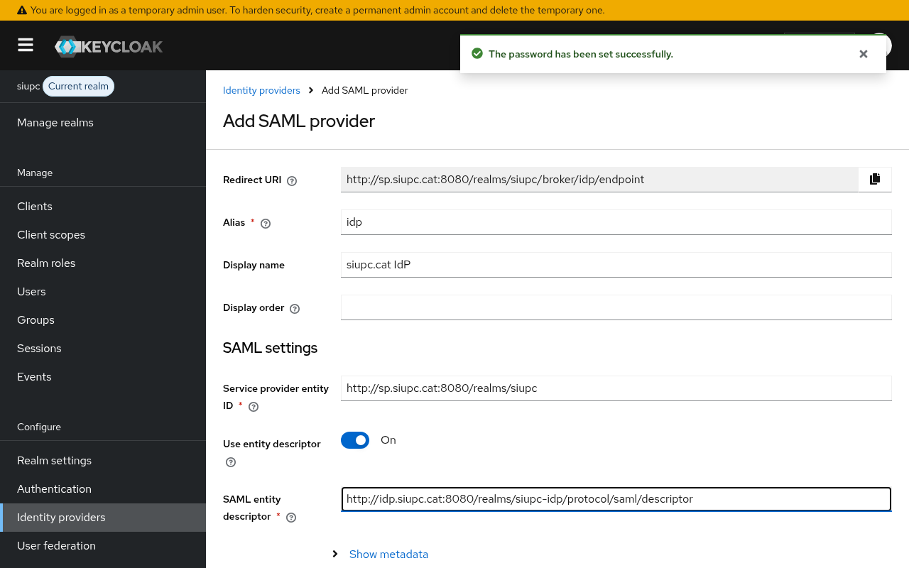

6. Now the Identity Provider has to trust the Service Provider. The descriptor
   of the Service Provider is at:

   ```text
   http://sp.siupc.cat:8080/realms/siupc/broker/idp/endpoint/descriptor
   ```

   Open that URL in a tab and save the page as `sp.xml` (`Ctrl+S`). If the import
   rejects the file, download the descriptor from the shell instead, which keeps
   the XML untouched:

   ```bash
   curl -x http://127.0.0.1:8008 -o sp.xml \
     http://sp.siupc.cat:8080/realms/siupc/broker/idp/endpoint/descriptor
   ```

7. Go back to the Identity Provider console
   (<http://idp.siupc.cat:8080/admin>), open **Clients**, click
   **Import client**, choose `sp.xml` and click **Save**. The client id becomes
   the entity id of the Service Provider, and the ACS URL and the signing
   certificate come from the file.

   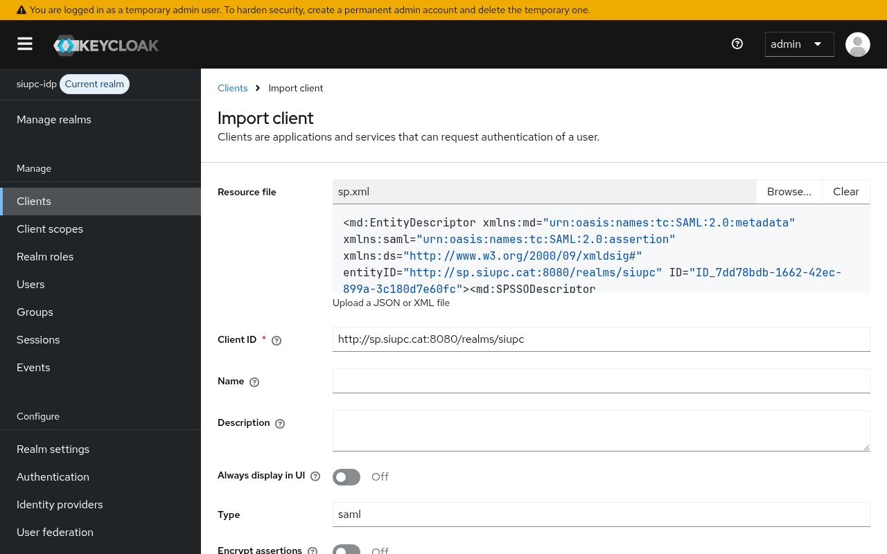

### Link the accounts

Now that we have created a couple of students, we need to map them together as
the same student. The Service Provider recognizes the account by the email that
the Identity Provider sends, and asks you to confirm that the account is yours.
To avoid having credential issues, make sure you do this in a private window, so
previous cookies are not used, and the login happens from scratch.

Open the login page of the Service Provider, and skip the local form by naming
the identity provider `idp`:

```text
http://sp.siupc.cat:8080/realms/siupc/protocol/openid-connect/auth?client_id=account&redirect_uri=http://sp.siupc.cat:8080/realms/siupc/account/&response_type=code&scope=openid&kc_idp_hint=idp
```

You land on the Identity Provider, where you log in as `student_idp`. Then you
return to the Service Provider, which does not know you yet. It asks for your
data, because the assertion carries a persistent identifier and no attributes:

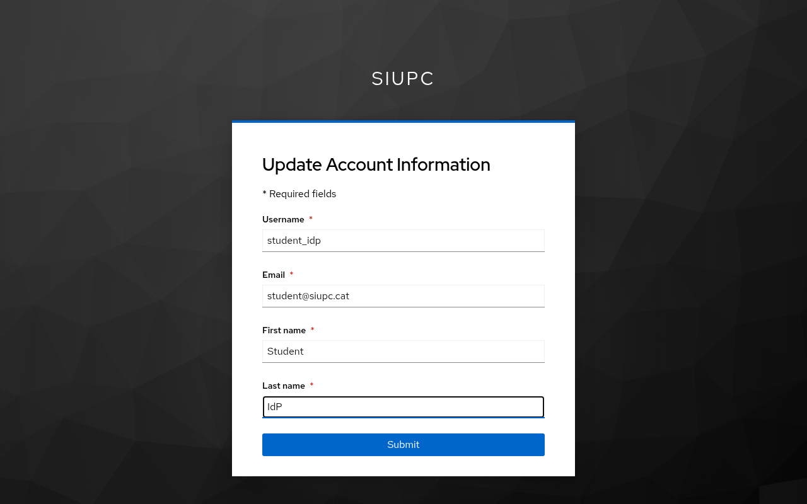

Fill in the username `student_idp`, the email `student@siupc.cat` and your name,
and click **Submit**. The email already belongs to `student_sp`, so Keycloak
offers to link the two accounts:

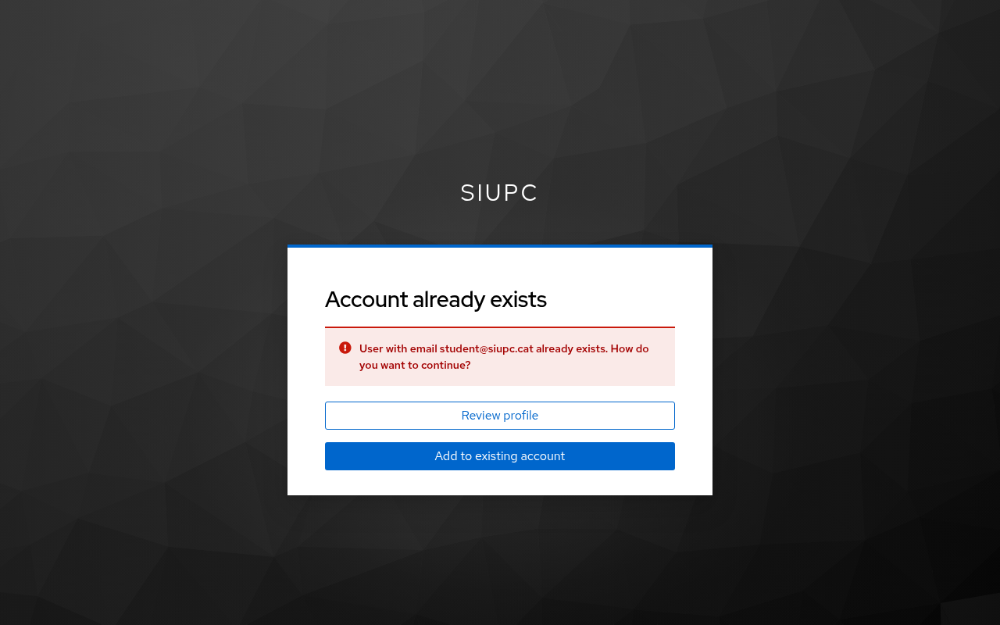

Click **Add to existing account**, and authenticate as `student_sp` to prove
that the local account is yours. You end up in the account console of the
Service Provider. Open a new tab and go to
<http://idp.siupc.cat:8080/realms/siupc-idp/account/>: the Identity Provider still
recognizes you as `Student IdP`, without asking for the password again.

You can see the result in the Service Provider console, under **Users** /
`student_sp` / **Identity provider links**:

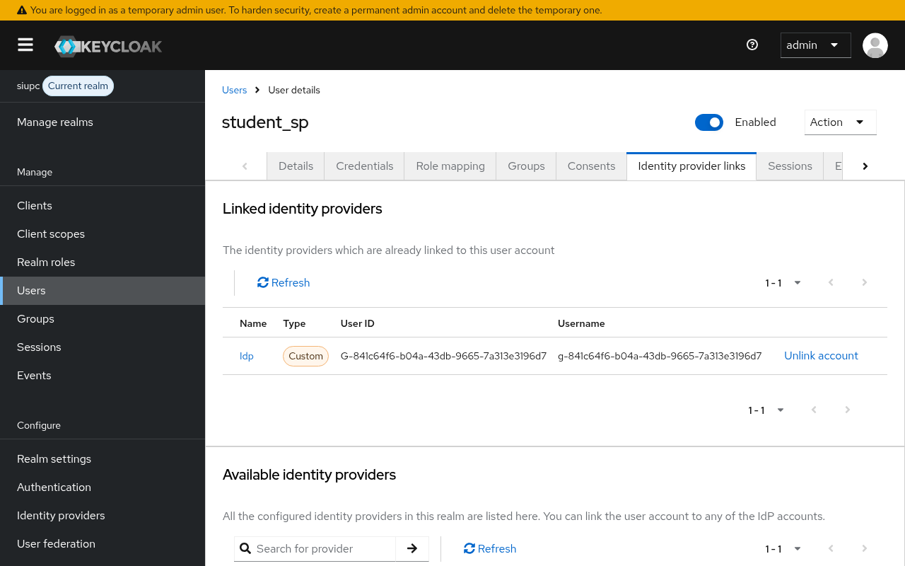

If something goes wrong, delete the cookies of the private window and start
again. To log out, use <http://sp.siupc.cat:8080/realms/siupc/account> and click
**Sign out**, then do the same on the Identity Provider with
<http://idp.siupc.cat:8080/realms/siupc-idp/account/>.

## Exercise

Now we have the goal of configuring a web page with access limitations to a
particular group of users. The page is served by an Apache server that acts as
the enforcement point: it asks the Service Provider for a token, and grants
access only when the token says that the user is an administrator.

First, create the users and the group on the Service Provider. Create the user
`si_user` (password: `acme1234`, temporary off, with your first and last name),
create the group `administrator` under **Groups**, and add the user to the group
with **Users** / `si_user` / **Groups** / **Join group**.

Second, create the client for the web server. Go to **Clients** / **Create
client** and:

- Set **Client ID** to `apache_agent` and click **Next**.
- Turn **Client authentication** off, keep **Standard flow** on, turn
  **Require PKCE** on, and click **Next**.
- Set **Valid redirect URIs** to `http://www.siupc.cat/redirect_uri` and
  **Web origins** to `http://www.siupc.cat`, then click **Save**.

It needs to look like:

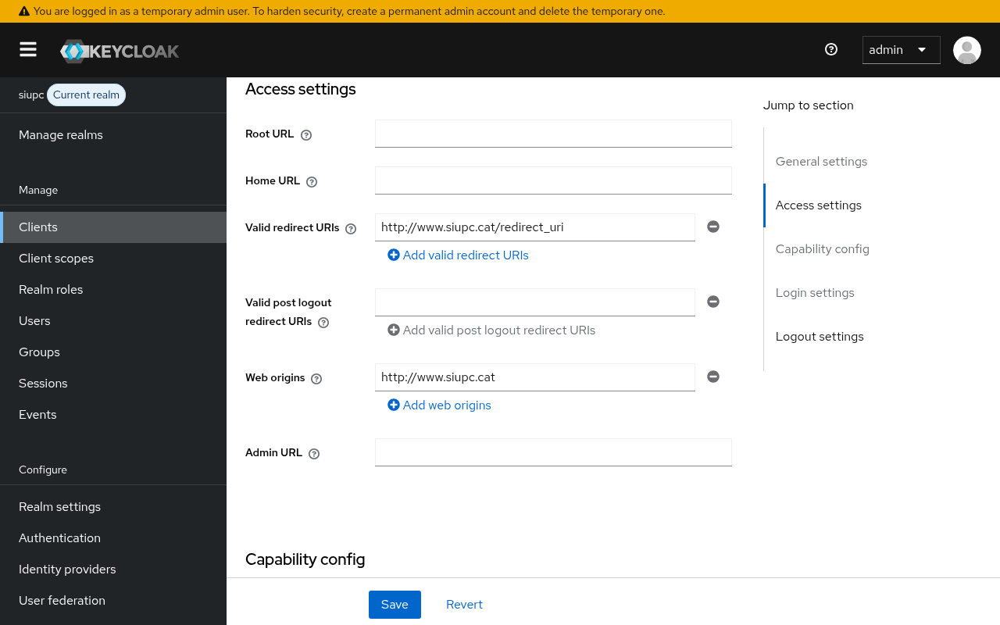

By default the token carries no group membership, and the Apache configuration
requires the `administrator` group. Add the claim with **Clients** /
`apache_agent` / **Client scopes** / `apache_agent-dedicated` / **Mappers** /
**Configure a new mapper** / **Group Membership**:

- Set **Name** and **Token Claim Name** to `groups`.
- Turn **Full group path** off, so the claim holds `administrator` and not
  `/administrator`.
- Click **Save**.

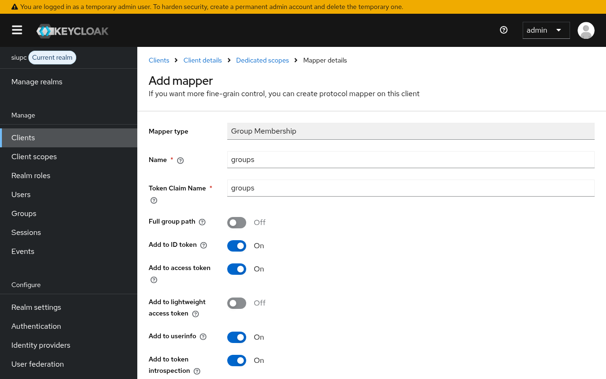

Now build and run the web server. The configuration in `lab3/apache` requires
the claim with the line `Require claim groups:administrator`:

```bash
podman build -t apache_agent lab3/apache
podman run -d --network keycloak -h www.siupc.cat --name apache_agent apache_agent
```

Nothing binds port 80 on the host. The proxy connects to the server inside the
network, where it listens on port 80.

Browse to <http://www.siupc.cat>. The server redirects you to the login page of
the Service Provider:

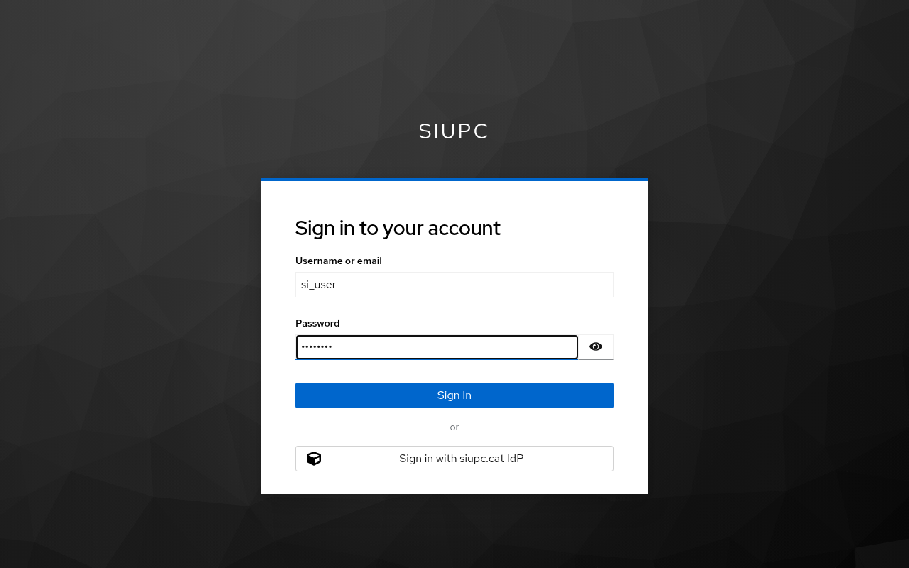

Log in as `si_user`. The Service Provider returns a token with the groups, the
claim matches, and the page says "It works!".

Test the other side too. Log out, open a private window, browse to
<http://www.siupc.cat> and log in as `student_sp`, who is not in the
`administrator` group. The claim is missing, so the server answers 401
Unauthorized.

**IMPORTANT:** To avoid messing up with the cookies, use a private window for
these tests. An active session skips the login form, and you will see the result
of the previous user. In case you see any HTTP 401 or 403 error on the apache
server, delete all cookies from your browser.

Now, you can capture the login traffic from inside the network. The login page
and the Keycloak cookies come from the Service Provider, so run a `tshark`
sidecar in the network namespace of the `sp_keycloak` container. Rootless Podman
drops `CAP_NET_RAW` and `CAP_NET_ADMIN`, so the sidecar needs the
`--cap-add=net_admin,net_raw` flag. Leave it running:

```bash
mkdir -p ~/capture
podman run --rm --cap-add=net_admin,net_raw \
  --network container:sp_keycloak docker.io/antrea/tshark \
  tshark -i eth0 -w - > ~/capture/keycloak.pcap
```

`eth0` is the interface that podman creates for the container. To list the
interfaces, run the same sidecar with `tshark -D` instead of `-i eth0`. To
capture on every interface, use `-i any`.

The capture goes to `~/capture/keycloak.pcap`. Start it before you log in and
stop it with `Ctrl+C` after access is granted, so the file holds the LOGIN flow.
Then open `~/capture/keycloak.pcap` in Wireshark and apply the `http` display
filter.

If Wireshark is not installed, print the cookies with `tshark` from the same
image:

```bash
podman run -i --rm docker.io/antrea/tshark \
  tshark -r - -Y http.set_cookie -T fields -e http.set_cookie \
  < ~/capture/keycloak.pcap
```

Return to Wireshark to locate the Keycloak cookies in the response to the login
request. The Service Provider sets both cookies together, and both carry the
path of the realm, `/realms/siupc/`.

**IMPORTANT:** Report only the cookies that LOGIN sets. At LOGOUT, Keycloak sets
the same cookies with empty values and `Max-Age=0`, and those are not valid for
this task. Test every `Set-Cookie` line: the value after `=` must not be empty.

```text
# LOGIN, non-empty value, keep these
Set-Cookie: KEYCLOAK_IDENTITY=eyJhbGciOi...; Version=1; Path=/realms/siupc/; HttpOnly
...
Set-Cookie: KEYCLOAK_SESSION=oyVDW99y...; Version=1; Path=/realms/siupc/; Max-Age=36000

# LOGOUT, empty value, not valid
Set-Cookie: KEYCLOAK_IDENTITY=; Version=1; Path=/realms/siupc/; Max-Age=0
```

To find a string within a packet, click on Edit > Find Packet (CTRL+F). Under
"Find By:" select "string" and enter your search string in the text entry box.
You'll probably want to leave "Case sensitive" unchecked. Under "Search in", the
default is "Packet list" but that will only find a string that appears in the
Info column of the Packet List pane, which is the one-line-per-packet summary
view. There is a lot more information in most packets than what appears in the
packet list Info column, so try "Packet details".

## Deliverables

Submit the following screenshots in Atenea. Use the given file name for each
one.

- `student_idp.png`: creation of the IdP user with your data.
- `student_sp.png`: creation of the SP user with your data.
- `sso_linked.png`: the "Account already exists" step of
  [Link the accounts](#link-the-accounts), or the identity provider links of
  `student_sp` after the link.
- `signin_keycloak.png`: the login page of `www.siupc.cat`, together with the
  terminal that runs the Apache server container.
- `signin_works.png`: the same as above after you enter the `si_user`
  credentials ("It works!").
- `wireshark1.png`: the `KEYCLOAK_IDENTITY` cookie, which identifies the
  authenticated user in the Service Provider.
- `wireshark2.png`: the `KEYCLOAK_SESSION` cookie, which tracks the session that
  the login opens.
- `keycloak.pcap`: the captured network traffic.

Wireshark must capture the whole HTTP message exchange.

## References

- <https://www.keycloak.org/docs/latest/server_admin/#_saml>
- <https://www.keycloak.org/docs/latest/securing_apps/>
- <https://github.com/OpenIDC/mod_auth_openidc>
